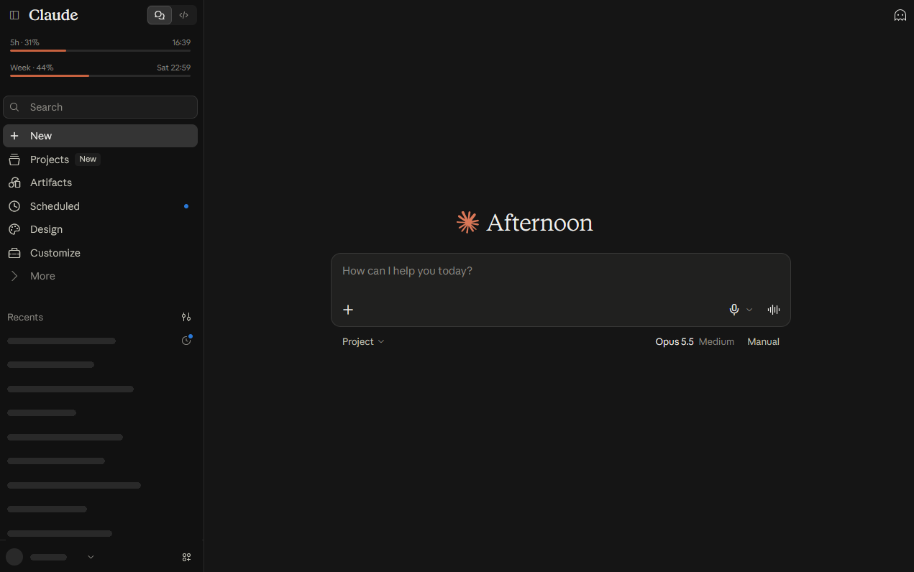
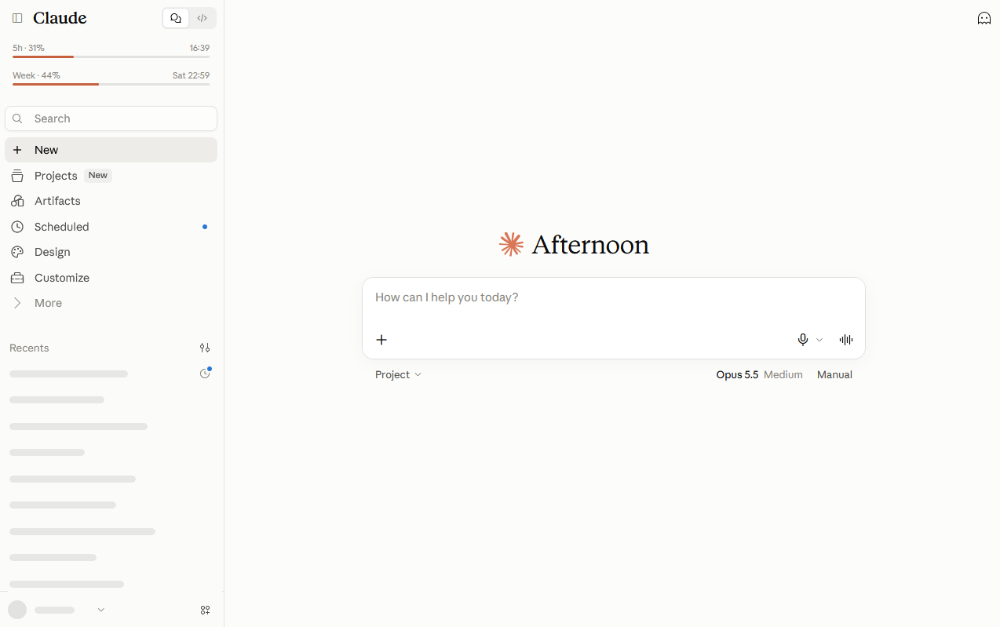
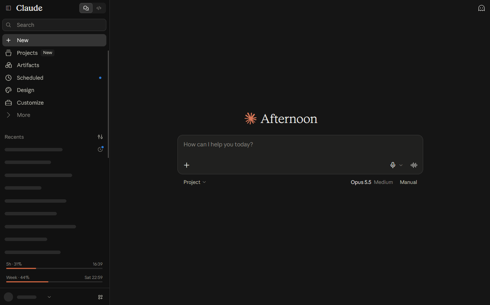
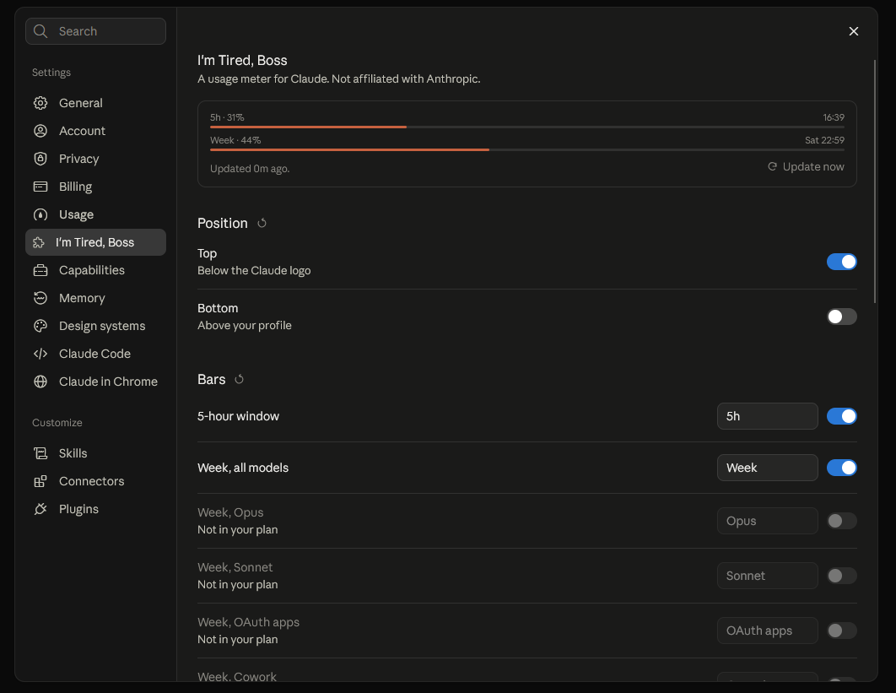
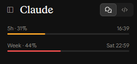
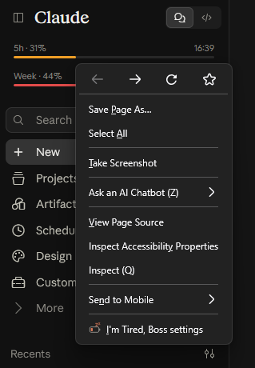

# I'm Tired, Boss – A usage meter for Claude

<p align="center">
  
</p>

A Firefox extension that shows your Claude plan limits as thin progress bars right in the claude.ai sidebar: the 5-hour window, your weekly limit and, if your plan has them, model-specific weekly limits and extra usage. Usage from Claude Code and the desktop app counts towards the same limits, so it shows up here too.

> **Not affiliated with or endorsed by Anthropic.** Claude is a trademark of Anthropic.
> This extension reads an internal, undocumented claude.ai endpoint. It can break whenever claude.ai changes.

## The idea

The goal was to make the usage bars feel like part of claude.ai itself, not like an add-on bolted on top. They sit where you already look, use claude.ai's own font, sizes and colors in light and dark mode, and stay quiet until you need them. Settings live in claude.ai's own settings dialog, right below "Usage", instead of in a separate page.

## Features

- Bars below the Claude logo and/or above your profile, styled with claude.ai's own font and colors (light and dark)
- Text above each bar: name, percent and reset time or time left, in your system's time format or 12h/24h
- Optional color change above usage thresholds
- Settings right inside claude.ai's settings dialog (below "Usage"), via right-click on the bars, or via the toolbar icon
- Expert mode with your own templates, e.g. `{name} · {pct}%` and `{reset:EEE HH:mm}` (Unicode LDML patterns)
- Toolbar badge with your 5-hour usage

## Screenshots

<table>
  <tr>
    <td align="center" width="50%">
      <br>
      <sub>Dark mode, below the Claude logo</sub>
    </td>
    <td align="center" width="50%">
      <br>
      <sub>Light mode: the bars follow claude.ai's theme</sub>
    </td>
  </tr>
  <tr>
    <td align="center" width="50%">
      <br>
      <sub>Alternative position above your profile</sub>
    </td>
    <td align="center" width="50%">
      <br>
      <sub>Settings as their own entry in claude.ai's settings dialog</sub>
    </td>
  </tr>
  <tr>
    <td align="center" width="50%">
      <br>
      <sub>Optional color change above usage thresholds</sub>
    </td>
    <td align="center" width="50%">
      <br>
      <sub>Right-click on the bars to open the settings</sub>
    </td>
  </tr>
</table>

## Privacy

The extension only talks to `claude.ai`, using your existing login. It does not collect anything and sends nothing anywhere else. No API key needed. See [PRIVACY.md](PRIVACY.md).

## Install

Install it from addons.mozilla.org: **[I'm Tired, Boss for Firefox](https://addons.mozilla.org/firefox/addon/im-tired-boss/)**. To build it from source, see Development below.

## Development

Requirements: Node.js 24+, Firefox 140+ (Nightly works well).

```bash
npm install
npm run watch   # rebuild on change (terminal 1)
npm start       # launch Firefox with the extension loaded (terminal 2)
```

If Firefox is not found, set `WEB_EXT_FIREFOX` to the path of `firefox.exe`.

| Script              | What it does                                  |
| ------------------- | --------------------------------------------- |
| `npm run build`     | Build into `dist/`                            |
| `npm run typecheck` | TypeScript check                              |
| `npm test`          | Unit tests (Vitest)                           |
| `npm run lint`      | ESLint and `web-ext lint` (run `build` first) |
| `npm run format`    | Format with Prettier                          |
| `npm run package`   | Clean build and zip in `web-ext-artifacts/`   |
| `npm run source`    | Source archive for addons.mozilla.org         |

### Building from source (for reviewers)

The add-on is built from this repository with a single command. Bundles are not minified.

1. Node.js 24 and npm 11
2. `npm ci`
3. `npm run package`

The result is `web-ext-artifacts/i_m_tired_boss_a_usage_meter_for_claude-<version>.zip`; its contents are identical to `dist/`. The bundles contain unmodified Preact from npm (MIT, see `THIRD_PARTY_NOTICES.txt` in the package); the `innerHTML` warnings from `web-ext lint` come from Preact's internals, the extension's own code never uses `innerHTML`. `npm run source` creates the source archive (`git archive` of the current commit).

Static files (manifest, HTML, icons, locales) live in `static/` and are copied into `dist/` on build. TypeScript sources live in `src/`. See [CONTRIBUTING.md](CONTRIBUTING.md).

## License

[MIT](LICENSE)
